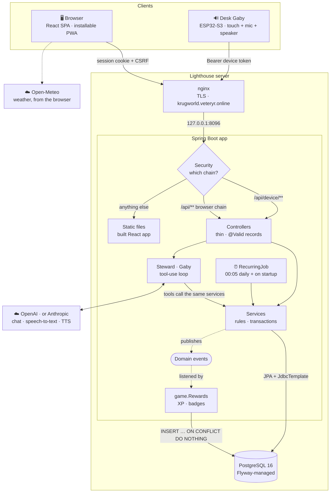
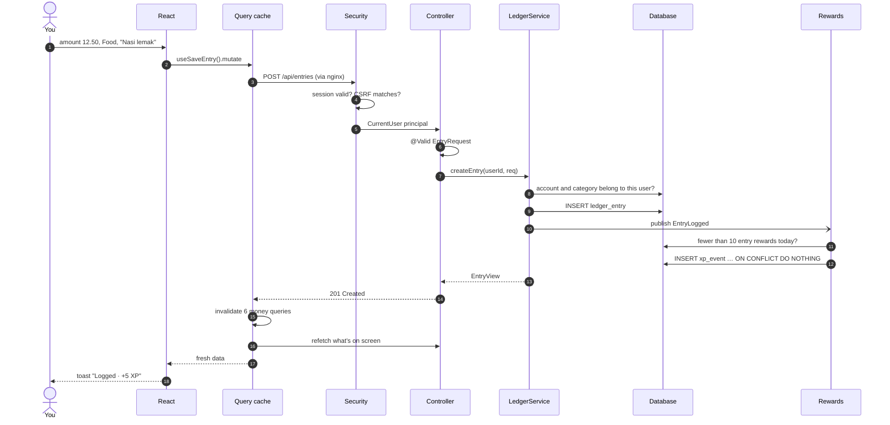
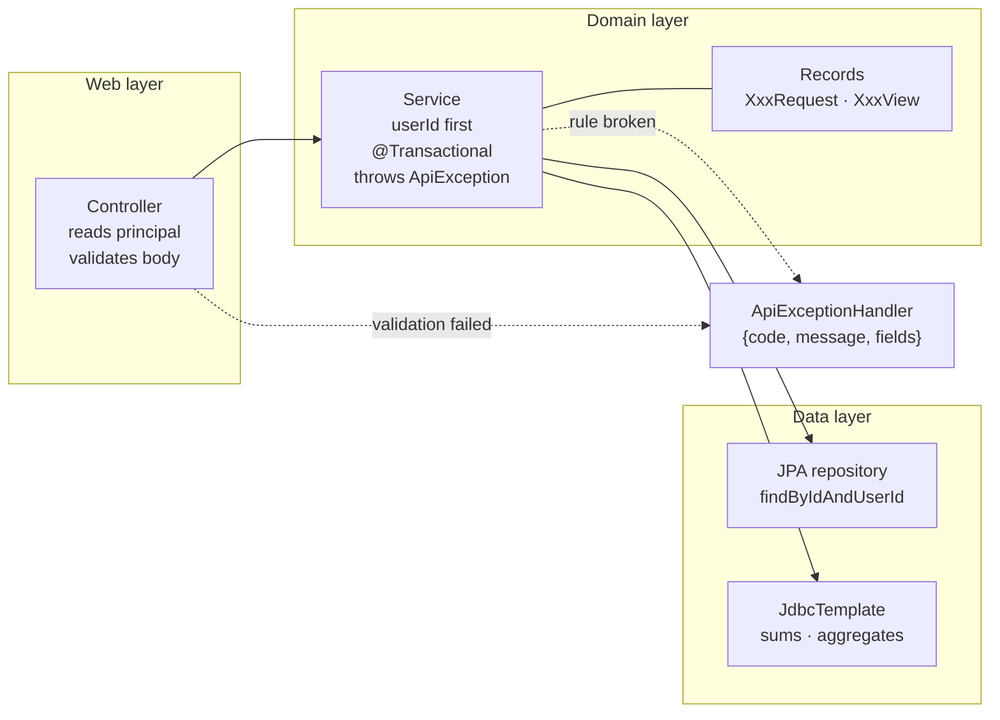
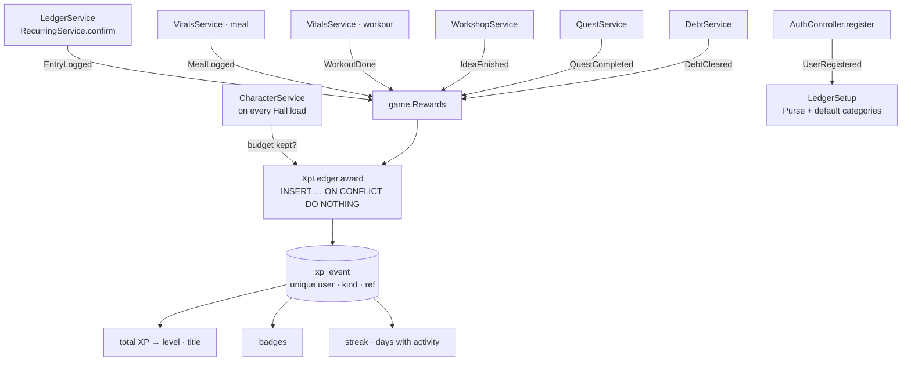
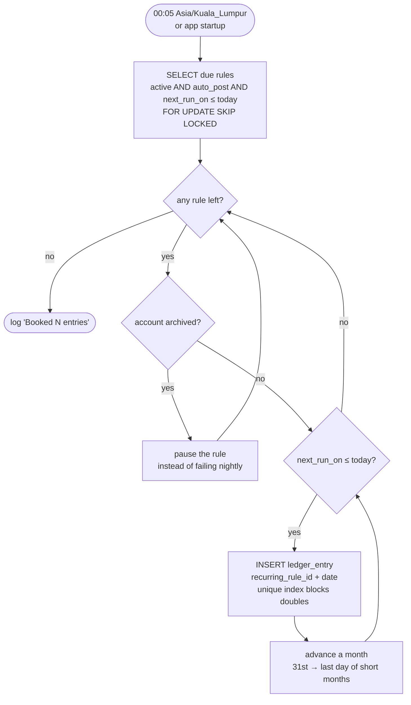
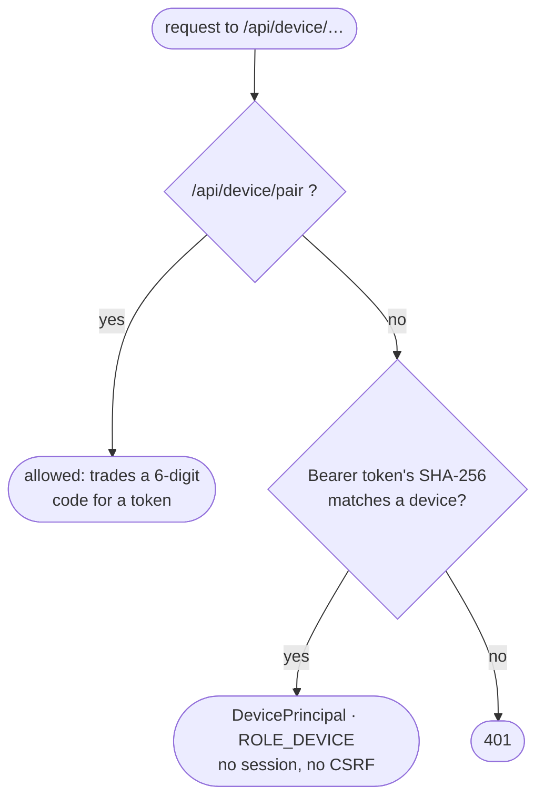
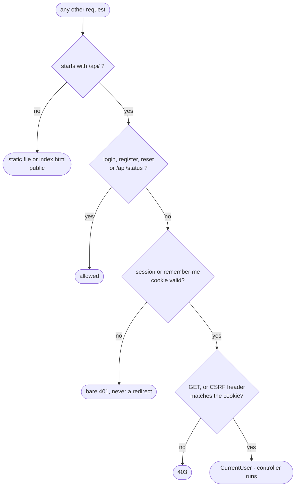
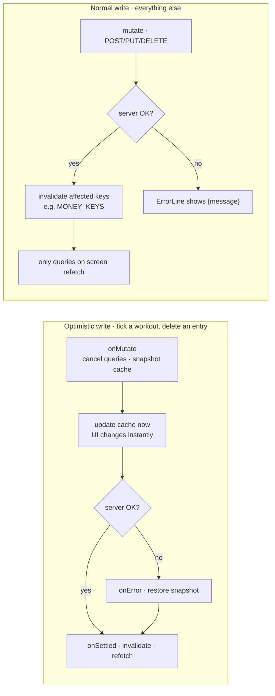
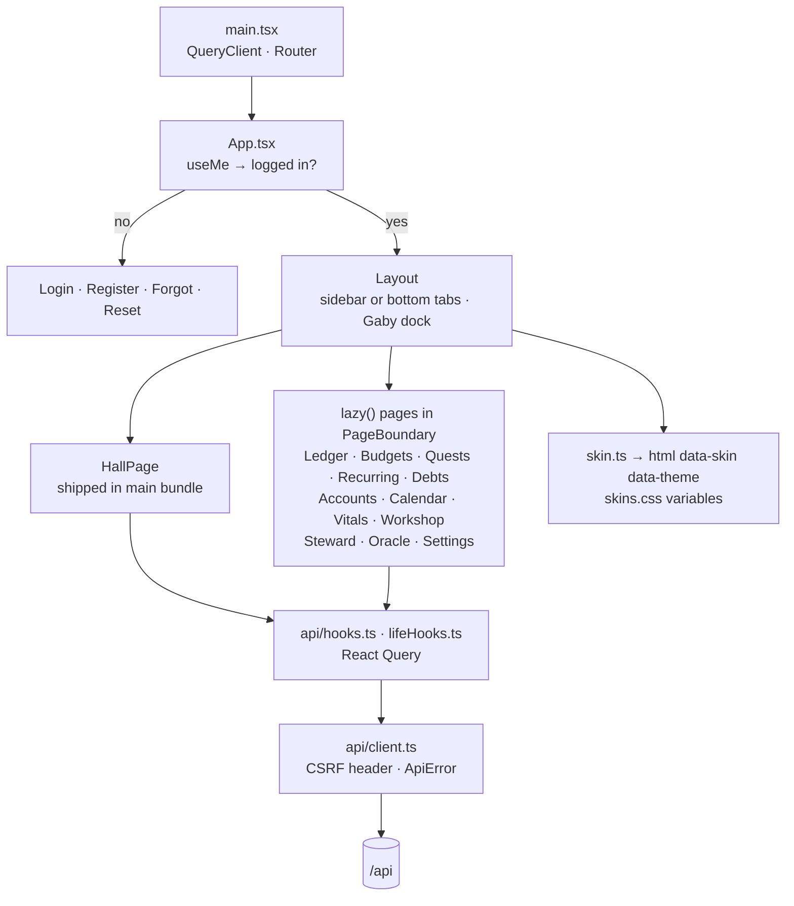

# Architecture

KrugWorld is one Spring Boot application that serves both the JSON API and the
built React app, backed by one PostgreSQL database. A desk device (an ESP32 "desk
Gaby") talks to the same server through its own small API.



## Why one jar

Shipping the frontend inside the backend jar means one artifact, one container, one
port, and no CORS: the app and the API share an origin, so the session cookie and the
CSRF cookie just work. In development Vite serves the frontend and proxies `/api` to
Spring, which keeps the same single-origin shape.

## Backend

Spring Boot 3.3 on Java 17. Each package is one feature and holds its own controller,
service, entities and repositories:

| Package | What it owns |
|---|---|
| `auth` | Users, login/registration, remember-me, preferences, password reset by email |
| `ledger` | Accounts, categories, ledger entries, month summaries |
| `budget` | Monthly budgets per expense category ("mana") |
| `recurring` | Monthly recurring entries, the nightly job, confirm/skip |
| `debt` | Debts between the user and other people, repayments |
| `quest` | Savings goals ("quests") |
| `game` | XP log, levels, badges, streaks, the character sheet |
| `calendar` | Calendar events |
| `vitals` | Meals/calories and the training plan |
| `workshop` | The idea board |
| `life` | "Today" aggregate (meals, workouts, upcoming events, ideas) |
| `steward` | Gaby: chat providers, tools, usage limits, speech |
| `device` | Desk device pairing, device API, Gaby's daily line |
| `importer` | One-off import from Krugger's Tavern |
| `web` | Forwards SPA routes to `index.html` |
| `status` | `/api/status` health and schema version |
| `common` | API errors, clock/time zone, scheduling switch |

### Life of a request

What happens when you log a RM 12.50 nasi lemak:



### Layers and conventions



- **Controllers** are thin: they read the principal, validate the body (`@Valid` on
  records) and call one service method.
- **Services** own the rules and the transaction (`@Transactional` on the class).
  Every method takes the user id first, and every lookup by id also filters by user
  (`findByIdAndUserId`), so another user's row looks exactly like a missing one (404).
- **Request/response shapes** are Java records next to the service
  (`DebtService.DebtRequest`, `DebtService.DebtView`). Entities never leave the service.
- **JPA** handles single-row writes; **JdbcTemplate** handles aggregates (balances,
  totals by category, repaid amounts), where plain SQL is clearer and faster than
  loading entities.
- **Money** is `NUMERIC(14,2)` in the database and `BigDecimal` in Java. The frontend
  sends amounts as two-decimal strings, so no floating-point rounding reaches the
  database.
- **Derived numbers are never stored.** Account balances are opening balance plus
  entries; a debt's outstanding amount is the amount minus repayments. Both are
  summed in SQL on read, so they can't drift from the history.
- **Errors** are always `{ "code", "message", "fields"? }` (`ApiExceptionHandler`).
  Services throw `ApiException.badRequest / notFound / conflict`; the frontend switches
  on `code` and shows `message`.

### Domain events and rewards

Features don't call the game directly. They publish a small event and `game.Rewards`
listens:



| Event | Published when | Reward |
|---|---|---|
| `EntryLogged` | A person logs an entry (or confirms a recurring one) | +5 XP, first 10 a day |
| `MealLogged` | A meal is logged | +5 XP, once per day |
| `WorkoutDone` | A workout is ticked | +10 XP, once per workout per day |
| `IdeaFinished` | An idea reaches DONE | +15 XP, once per idea |
| `QuestCompleted` | A quest reaches its target | +200 XP, once per quest |
| `DebtCleared` | A debt is repaid in full | +10 XP, once per debt |
| `UserRegistered` | An account is created | default account and categories (`LedgerSetup`) |

Every reward is an `INSERT … ON CONFLICT DO NOTHING` into `xp_event`, whose unique key
is `(user_id, kind, ref)`. That makes paying out **idempotent**: re-checking, a double
click or a retried request can never pay twice. "Budget kept" XP (+50 per budget per
finished month) uses the same trick: it is re-checked every time the character sheet
is opened instead of by a month-end job.

### Scheduling

`RecurringJob` runs at 00:05 in the app's time zone (`krugworld.zone`, default
`Asia/Kuala_Lumpur`) and once at startup to catch up after downtime. It locks due rules
with `FOR UPDATE SKIP LOCKED`, and a partial unique index on
`(recurring_rule_id, occurred_on)` makes a double booking impossible even if two
instances run at once. Rules set to "wait for my confirm" are skipped by the job.



Time is always read through an injected `Clock` (`common/TimeConfig`), so "today",
month boundaries and streaks follow the configured zone, not the server's, and tests
can control it.

### Security

Two filter chains (`auth/SecurityConfig`):

1. **Device chain**, `/api/device/**`, checked first: stateless, bearer token only
   (`DeviceTokenFilter`), principal `DevicePrincipal`, role `ROLE_DEVICE`. No cookies,
   so no CSRF. Device tokens are random; only their SHA-256 is stored.
2. **Browser chain**, everything else: session cookie plus a signed, year-long
   remember-me cookie (its key lives in `app_secret` so deploys don't log everyone
   out), CSRF via the `XSRF-TOKEN` cookie echoed in the `X-XSRF-TOKEN` header.
   `/api/**` needs a login except login, register and password reset. A missing login
   is a bare 401, never a redirect.

Non-API paths are public static files; the SPA asks `/api/auth/me` who you are.

The device chain, checked first:



Everything else, the browser chain:



### Gaby (the Steward)

See [GABY.md](GABY.md). In short: a stateless tool-use loop. The browser sends the
recent conversation; the server lets the model call up to 8 rounds of tools (thin
wrappers over the same services the screens use, so the same rules and XP apply) and
returns the reply plus an English subtitle.

## Frontend

React 19 + TypeScript + Vite 8, React Query for server state, react-router, Tabler
icons. `npm run lint` (oxlint) is kept at zero warnings.

```
frontend/src/
  App.tsx            routes; every page except the Hall is a lazy() chunk
  api/client.ts      the only fetch wrapper: CSRF header, error -> ApiError
  api/types.ts       TypeScript shapes of the API
  api/hooks.ts       React Query hooks for money features (+ invalidation)
  api/lifeHooks.ts   hooks for calendar, vitals, workshop, steward
  components/        Layout, nav, ui primitives, Hall widgets, dialogs
  pages/             one file per page
  steward/           Gaby's portrait, chat and dock
  skin/skin.ts       applies the account's skin/theme to <html>
  styles/skins.css   skin variables; app.css uses only those variables
```

- **Server state** lives in React Query. After a write, hooks invalidate the keys whose
  data changed (an entry changes entries, accounts, summary, budgets, the character
  sheet and recurring). A few writes are **optimistic** (`onMutate` + rollback): ticking
  a workout and deleting an entry.




- **Skins** are CSS variables on `<html data-skin data-theme>`. Components only use the
  variables, so a new theme is a block of variables, not a component change. *Classic
  Krugger* reproduces the old Tavern exactly; the KrugWorld skin has four backgrounds.
- **Layout**: grouped navigation (Hall · Finance · Life · Arcane · Settings); on phones
  each group is a tab in a bottom bar. The Hall's grid uses container queries on
  `main`, so it adapts to the room actually left when Gaby's dock is open.
- **PWA**: `vite-plugin-pwa` caches the app shell only. `/api` is never cached, so the
  app never shows stale money.
- **SPA routes**: any new route must also be added to `web/SpaController` so a refresh
  on that URL serves `index.html` instead of a 404.

## Desk device

`firmware/` holds the PlatformIO + Arduino + LVGL firmware for the Waveshare
ESP32-S3-Touch-LCD-4B. It pairs with a six-digit code from Settings, shows a glance
screen (Gaby's face, today's numbers, workouts to tick) and does tap-to-talk voice.
Its API is documented in [DEVICE-API.md](DEVICE-API.md).

## Deployment shape

One `postgres:16` container and one app container (`eclipse-temurin:17-jre` running
the jar) per `deploy/docker-compose.yml`, on a shared Lighthouse server behind the
host's nginx and Let's Encrypt. The jar is built on a developer machine; nothing is
compiled on the server. See [OPERATIONS.md](OPERATIONS.md) and `../DEPLOY.md`.
