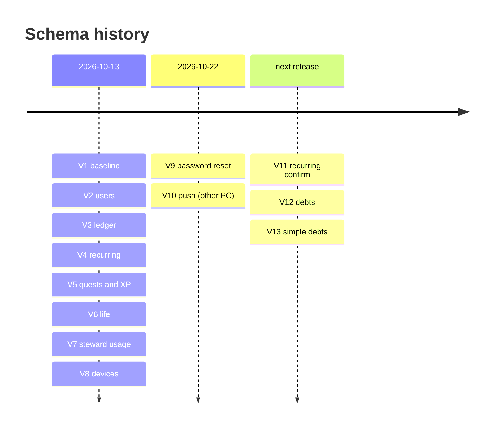
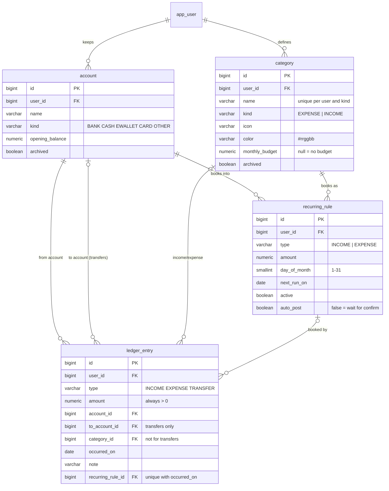
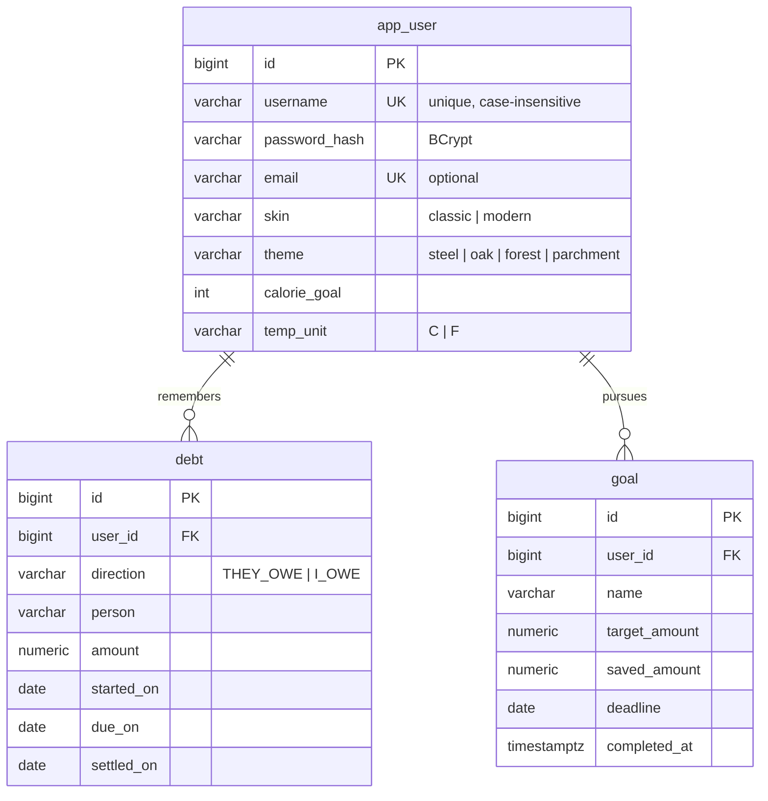
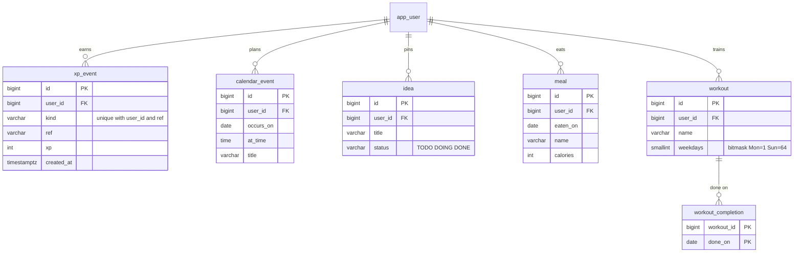
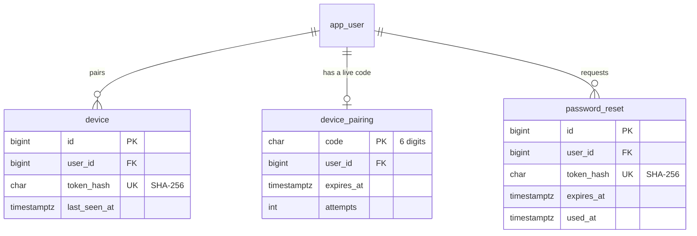
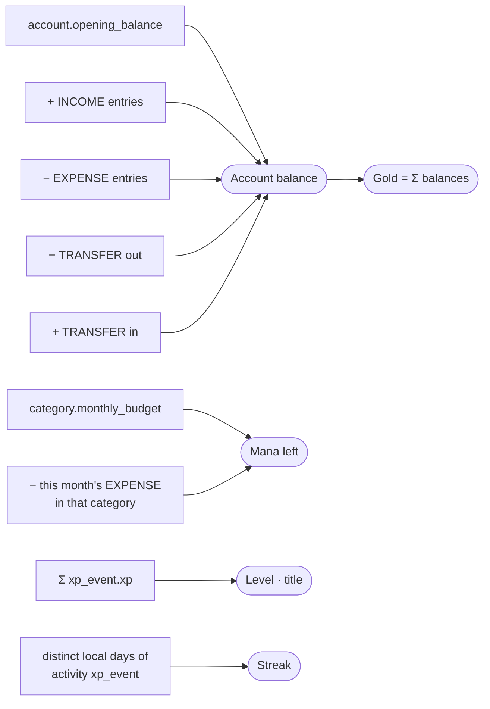

# Database

PostgreSQL 16. The schema is owned by **Flyway** (`backend/src/main/resources/db/migration`);
Hibernate runs with `ddl-auto=validate`, so it only checks that the entity classes match
what Flyway built and refuses to start if they don't.

## Rules for changing the schema

- **Never edit a migration that has run anywhere** (your PC, the server). Flyway stores a
  checksum of every applied file and will refuse to start if one changes. Add a new
  `V<n>__what.sql` instead.
- **Pick the next number from production, not from your checkout.** Two machines that
  each add "the next" migration will both create the same `V<n>`, and the second deploy
  fails with *checksum mismatch* (this happened on 2026-10-23; see
  [OPERATIONS.md](OPERATIONS.md#lessons)). Pull first; check
  `SELECT max(version::int) FROM flyway_schema_history` on the server if in doubt.
- Put the "why" in a comment at the top of each migration, and enforce rules in the
  database too (CHECK constraints, unique indexes), not only in Java.

## Migrations

| Version | File | Adds |
|---|---|---|
| 1 | `V1__baseline.sql` | `app_meta` |
| 2 | `V2__users.sql` | `app_user`, `app_secret` |
| 3 | `V3__ledger.sql` | `account`, `category`, `ledger_entry` |
| 4 | `V4__recurring.sql` | `recurring_rule`, `ledger_entry.recurring_rule_id` |
| 5 | `V5__quests_and_xp.sql` | `goal`, `xp_event` |
| 6 | `V6__life.sql` | `calendar_event`, `idea`, `meal`, `workout`, `workout_completion`, user settings |
| 7 | `V7__steward_usage.sql` | `steward_usage` |
| 8 | `V8__devices.sql` | `device`, `device_pairing` |
| 9 | `V9__password_reset.sql` | `app_user.email`, `password_reset` |
| 10 | `V10__push.sql` | push notifications (`push_subscription`). **Deployed from the other PC, not yet in this repo**; document it here when that code is merged. |
| 11 | `V11__recurring_confirm.sql` | `recurring_rule.auto_post` |
| 12 | `V12__debts.sql` | `debt`, `debt_payment` |
| 13 | `V13__simple_debts.sql` | drops `debt_payment`: debts are ticked off, not repaid in parts |

Every table that belongs to a person has `user_id … REFERENCES app_user (id) ON DELETE
CASCADE`, so deleting an account removes everything it owned.



## Entity relationships

Every table hangs off `app_user`. Split into three pictures so each stays readable.

### Ledger and recurring



### Debts and quests



### Game and life



### Accounts, devices and security



`app_secret`, `steward_usage` and `app_meta` stand alone (no foreign keys).

### How derived numbers are computed

Nothing below is stored; each is summed from history on read.



## Tables

### Accounts and security

**`app_user`**: one row per login.

| Column | Type | Notes |
|---|---|---|
| `id` | BIGSERIAL PK | |
| `username` | VARCHAR(40) | unique ignoring case (`ux_app_user_username` on `lower(username)`) |
| `password_hash` | VARCHAR(100) | BCrypt |
| `email` | VARCHAR(254) NULL | optional, unique ignoring case; needed only for password reset |
| `skin` | VARCHAR(20) | `classic` or `modern` |
| `theme` | VARCHAR(20) | `steel`, `oak`, `forest`, `parchment` |
| `calorie_goal` | INTEGER | 500–10000, default 2000 |
| `weather_place`, `weather_lat`, `weather_lon` | | optional location for the Hall's weather |
| `temp_unit` | VARCHAR(1) | `C` or `F` |
| `created_at` | TIMESTAMPTZ | |

**`app_secret`**: secrets generated on first boot (e.g. the remember-me signing key),
kept in the database so redeploys don't log everyone out.

**`password_reset`**: one row per reset link. Only the SHA-256 of the token is stored;
`used_at` makes a link single-use and `expires_at` limits it to 30 minutes.

**`device`** / **`device_pairing`**: paired desk devices (token stored as SHA-256 only)
and short-lived six-digit pairing codes (10 minutes, limited attempts, one live code per
user).

**`steward_usage`**: Gaby's daily message counters, `(scope, day)` with scope
`user:<id>` or `global`.

### Money

**`account`**: where money lives. `kind` is `BANK`, `CASH`, `EWALLET`, `CARD` or
`OTHER`; `opening_balance` is the balance before the first entry. `archived` hides it
from pickers but keeps its history. Deleting an account with entries archives it instead.

**`category`**: what money was for. `kind` is `EXPENSE` or `INCOME`; `icon` is one of a
fixed set of keys; `color` is `#rrggbb`; `monthly_budget` (expense only, NULL = no budget)
drives Budgets. Unique per user on `(kind, lower(name))`. Deleting a used category
archives it and clears its budget.

**`ledger_entry`**: every movement of money.

| Column | Notes |
|---|---|
| `type` | `INCOME`, `EXPENSE` or `TRANSFER` |
| `amount` | NUMERIC(14,2), always > 0; the type carries the direction |
| `account_id` | source account |
| `to_account_id` | transfers only, must differ from `account_id` |
| `category_id` | income/expense only; transfers never have one |
| `occurred_on` | a calendar DATE, never an instant |
| `recurring_rule_id` | set when a recurring rule made it |

`ck_entry_shape` enforces the transfer/category rule in the database. The ledger screen's
query (one user, one month, newest first) is served by `ix_entry_user_date`.

**Balance** of an account = `opening_balance` + income − expenses − transfers out +
transfers in, summed by `LedgerQueries` on read.

**`recurring_rule`**: monthly income/expense templates.

| Column | Notes |
|---|---|
| `type`, `amount`, `account_id`, `category_id`, `note` | copied onto each entry |
| `day_of_month` | 1–31; 29–31 fall on the last day of shorter months |
| `next_run_on` | the next date it's due |
| `active` | paused rules do nothing |
| `auto_post` | `true`: the nightly job books it. `false`: it waits for the user to confirm or skip |

`ux_entry_rule_date` (unique on `(recurring_rule_id, occurred_on)` where set) guarantees
one entry per rule per date, whoever books it.

**`goal`**: savings quests: `target_amount`, `saved_amount`, optional `deadline`,
`completed_at` (set once, never unset).

**`debt`**: promises between the user and other people.

| `debt` column | Notes |
|---|---|
| `direction` | `THEY_OWE` (someone owes the user) or `I_OWE` |
| `person` | free text, e.g. "Ali" |
| `amount` | the original amount, > 0 |
| `note`, `started_on`, `due_on` | `due_on` optional |
| `settled_on` | the day it was ticked off as settled; `null` while still owed |

V12 also made `debt_payment` for partial repayments; V13 dropped it again (debts are now
simply ticked off), without editing V12, since migrations only move forward. Before
dropping it, V13 folds partial repayments into open debts: the amount becomes what was
still owed, and the note keeps "was RM 120.00, RM 50.00 paid back". Debts are
kept apart from the ledger on purpose: they record who owes whom, not money in an
account.

### Game

**`xp_event`**: an append-only log of every reward earned.

| Column | Notes |
|---|---|
| `kind` | `ENTRY_LOGGED`, `MEAL_LOGGED`, `WORKOUT_DONE`, `IDEA_DONE`, `QUEST_COMPLETE`, `BUDGET_KEPT`, `DEBT_CLEARED` |
| `ref` | what it was for, e.g. an entry id, `2026-09:12` (month:category), `7:2026-10-23` (workout:day) |
| `xp` | > 0 |
| `created_at` | its local date is what streaks count |

`ux_xp_event (user_id, kind, ref)` makes every reward payable once. Total XP, level,
badges and streaks are all derived from this table on read.

### Life

**`calendar_event`**: `occurs_on` DATE, optional `at_time`, `title`.

**`idea`**: workshop board; `status` `TODO` → `DOING` → `DONE`.

**`meal`**: `eaten_on`, `name`, `calories` (0–20000).

**`workout`** + **`workout_completion`**: a workout's planned weekdays are a bitmask
(Mon = 1 … Sun = 64, 0 = any day); a completion is `(workout_id, done_on)` as the primary
key, so ticking twice on one day is impossible.

## Handy queries

```sql
-- Which migrations have run
SELECT installed_rank, version, description, installed_on, success
FROM flyway_schema_history ORDER BY installed_rank;

-- One user's account balances
SELECT a.name,
       a.opening_balance
       + COALESCE(SUM(CASE WHEN e.type = 'INCOME'  AND e.account_id = a.id THEN e.amount END), 0)
       - COALESCE(SUM(CASE WHEN e.type IN ('EXPENSE', 'TRANSFER') AND e.account_id = a.id THEN e.amount END), 0)
       + COALESCE(SUM(CASE WHEN e.type = 'TRANSFER' AND e.to_account_id = a.id THEN e.amount END), 0) AS balance
FROM account a
LEFT JOIN ledger_entry e ON e.account_id = a.id OR e.to_account_id = a.id
WHERE a.user_id = :user
GROUP BY a.id;

-- What's owed each way, open debts only
SELECT d.direction, SUM(d.amount) AS total
FROM debt d
WHERE d.user_id = :user AND d.settled_on IS NULL
GROUP BY d.direction;
```

## Backups

See [OPERATIONS.md](OPERATIONS.md#backups). Take one before every release that adds a
migration.
