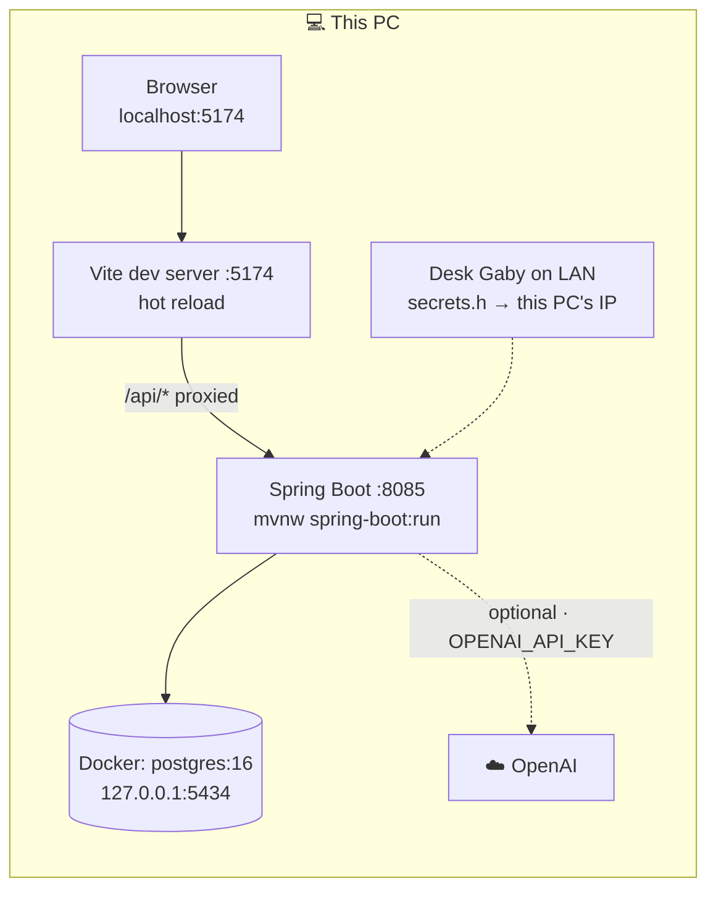
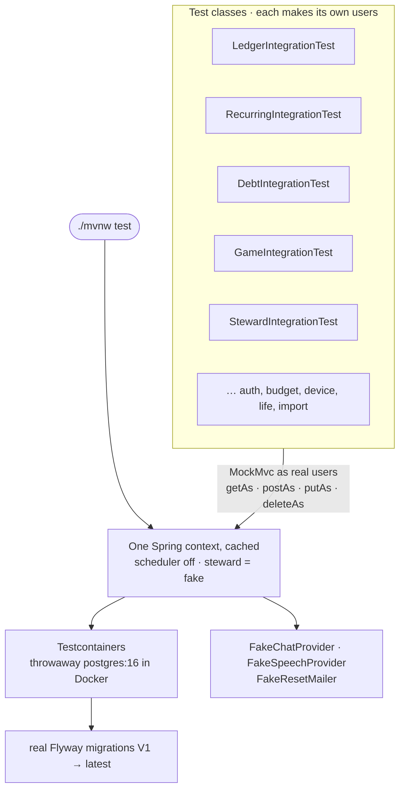
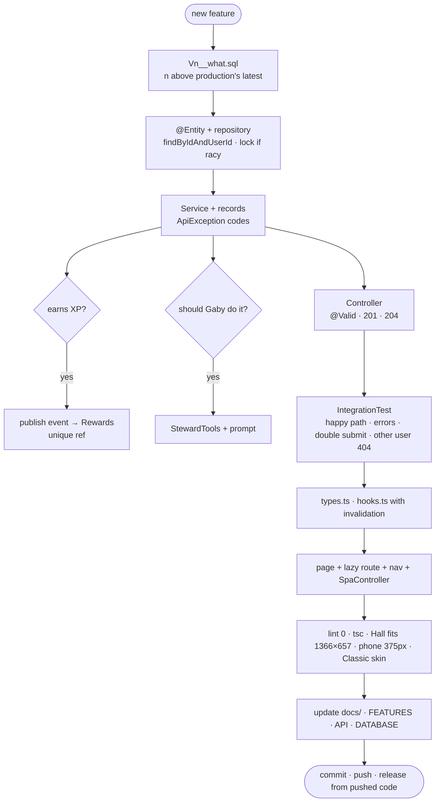

# Development

First-time setup on a machine (JDK 17, Node 20+, Docker Desktop): see
[SETUP-NEW-PC.md](SETUP-NEW-PC.md). This page is the day-to-day.

## Run it locally

```bash
docker compose up -d db                 # Postgres on 127.0.0.1:5434
cd backend && ./mvnw spring-boot:run    # API on :8085 (Windows: .\mvnw.cmd spring-boot:run)
cd frontend && npm run dev              # app on :5174, proxies /api to :8085
```

Open http://localhost:5174 and register an account (local only).



| Port | What | Set in |
|---|---|---|
| 5434 | local Postgres | `docker-compose.yml`, `application.properties` |
| 8085 | backend (`PORT` overrides) | `application.properties` |
| 5174 | Vite dev server and its `/api` proxy target | `frontend/vite.config.ts` |

If 5174 is taken by another project, run Vite on another port; the proxy still points at
8085: `npm run dev -- --port 5175 --strictPort`.

Optional environment for Gaby locally: `OPENAI_API_KEY` (read it from the key file
outside the repo; never commit or print it).

## Tests

```bash
cd backend && ./mvnw test        # needs Docker running
cd frontend && npm run lint      # must stay at zero warnings
cd frontend && npx tsc -b        # type check
```

Backend tests are **integration tests against real Postgres**: `IntegrationTest` starts one
Testcontainers `postgres:16` shared by every test class, runs the real Flyway migrations,
and drives the API through MockMvc as real users (`newUser()`, `getAs`, `postAs`, …).
Tests never assume an empty database; each makes its own uniquely named users. The
scheduler is off and Gaby runs on scripted fakes, so tests are offline and free.

Testcontainers is pinned to **1.21.4**: older versions fail against Docker 29.



CI (`.github/workflows/ci.yml`) runs lint, the frontend build and all backend tests on
every push to `main` and on pull requests.

## Adding a feature: checklist



Backend
1. **Migration**: `V<n>__what.sql` with the next number **from production** (see
   [DATABASE.md](DATABASE.md)). Constraints and indexes in SQL; a comment explaining why.
2. **Entity** (`@Entity`, matching columns exactly; Hibernate validates) and a repository
   with `findByIdAndUserId`. Lock the row (`@Lock(PESSIMISTIC_WRITE)`) where two quick
   requests could race (confirming, paying).
3. **Service** with request/view records, `@Transactional`, user id first on every method,
   `ApiException` for rule failures (stable `code`, human `message`).
4. **Controller**: thin, `@Valid` bodies, `201` for creates, `204` for deletes.
5. **Rewards**: publish an event and award in `game/Rewards` via `XpLedger.award` with a
   unique `ref`; never write XP from the feature itself.
6. **Gaby**: add tools in `StewardTools` if she should be able to do it, and mention the
   feature in the system prompt's list.
7. **Tests**: an `…IntegrationTest` covering the happy path, each rule's error code,
   idempotency (double submit) and another user's id returning 404.

Frontend
1. Types in `api/types.ts`, hooks in `api/hooks.ts` (or `lifeHooks.ts`) that invalidate
   every query the write affects.
2. A page in `pages/`, loaded with `page(() => import(...))` in `App.tsx`.
3. A nav entry in `components/nav.ts` and the route in **`web/SpaController`** (or a
   refresh on that URL is a 404).
4. Styles only through the skin variables (`var(--accent)`, `var(--hp)`, …), and check the
   *Classic Krugger* skin.
5. Check the Hall still fits 1366×657 if you touched it, plus a phone width (375 px).

## Code conventions

- Money: `BigDecimal` / `NUMERIC(14,2)`; the frontend sends `"12.50"` strings via
  `money()` and displays with `rm()`.
- Dates are local calendar dates (`LocalDate`, `"2026-10-23"`), built from local parts in
  the browser (`lib/format.ts`), never `toISOString()`.
- Read time through the injected `Clock`, never `LocalDate.now()` without it.
- Never annotate a `String` column with `@Lob` (it breaks Postgres reads outside a
  transaction).
- Comments explain *why*, not what.
- Optimistic UI only where a wrong guess is harmless and easy to roll back
  (`onMutate` + restore in `onError`).
- For a React Query callback that must run even if the component unmounts after the
  refetch (e.g. a toast after the last item disappears), await `mutateAsync` instead of
  passing `onSuccess` to `mutate`.

## Useful local tricks

- `GET /api/status` shows the applied schema version.
- Reset the local database completely: `docker compose down -v` then `up -d db` (deletes
  all local data).
- If you renumber a migration that already ran **locally**, Flyway will refuse to start on
  your local database. Either reset it as above, or delete those rows from
  `flyway_schema_history` and drop what they created. Never do this on production.
