# Features and game rules

A tour of every screen, then the rules of the game: how XP, levels, badges and streaks
work. Navigation is grouped as **Hall · Finance · Life · Arcane · Settings**; on phones
each group is a tab in the bottom bar.

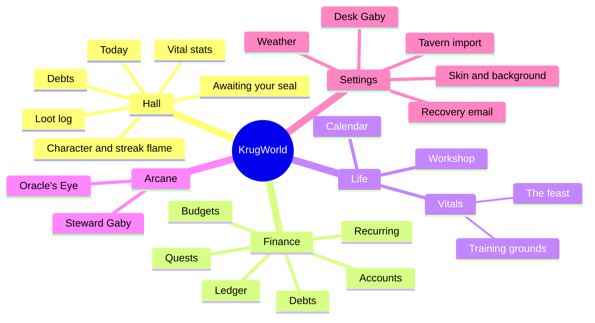

### A day in KrugWorld

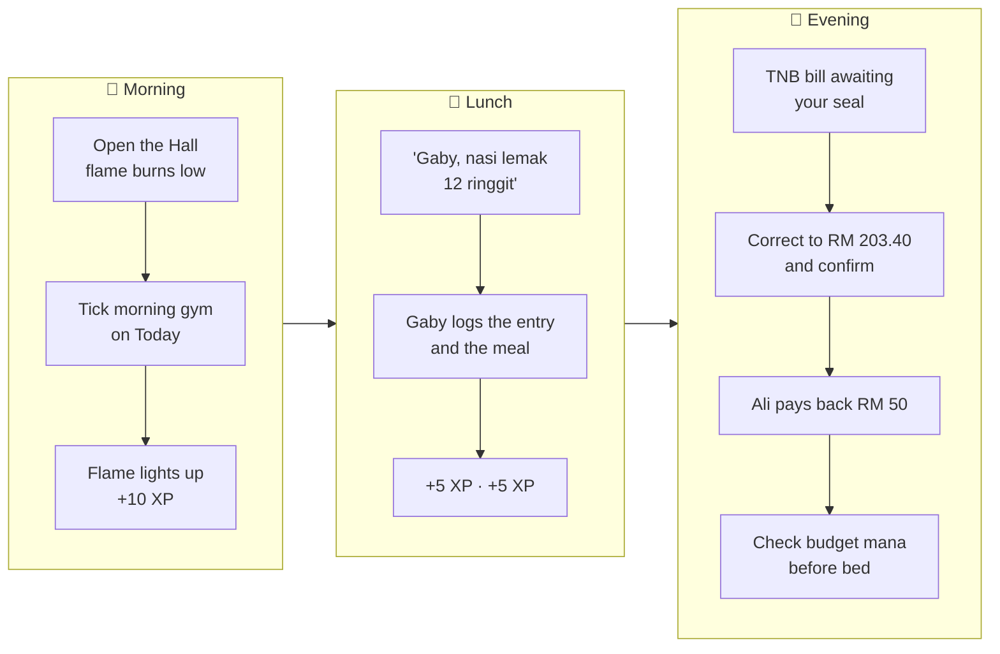

## The Hall

The landing page: your life as an RPG character sheet. It fits one laptop screen
(1366×657 and up) with Gaby's dock closed. Read it like a sheet:

- **Left: who you are.** The character card: an avatar ring that fills with XP towards
  the next level, your level and title, the XP bar, and the badge grid (locked badges
  are dashed). The **streak flame** sits on the corner of the avatar with the day count
  inside it:
  - **burning** (flickers): you've already done something today;
  - **low** (dim, breathing): the streak is alive but today is still empty;
  - **cold** (grey, 0): no streak. Hovering shows your best streak and how many of the
    last 7 days you were active.

  Below it, **Active quests**: up to three savings goals with progress bars.
- **Top row: the state of your purse**, two halves side by side:
  - **Vital stats**: *Gold* (total balance) as the HP bar against this month's money,
    *Budget mana* (what's left of this month's budgets, with days left), and this
    month's money in and out.
  - **Debts**: what you're owed and what you owe, a tug-of-war bar between them, and the
    three most pressing debts (overdue first, then soonest due).
- **Below: what wants doing, then what happened.**
  - **Awaiting your seal** (only when something is due): recurring entries set to
    "wait for my confirm" whose day has come. The wax-seal button opens the confirm
    dialog.
  - **Today**: calories against the goal, today's planned workouts (tick them off),
    upcoming events and ideas in progress.
  - **Loot log**: the latest ledger entries.

The title bar shows the greeting, the weather for your saved location (Open-Meteo, called
from the browser) and the **Log entry** button.

On medium widths (for example with Gaby docked) the purse row goes across the top and the
hero sits under it; on phones everything is one column.

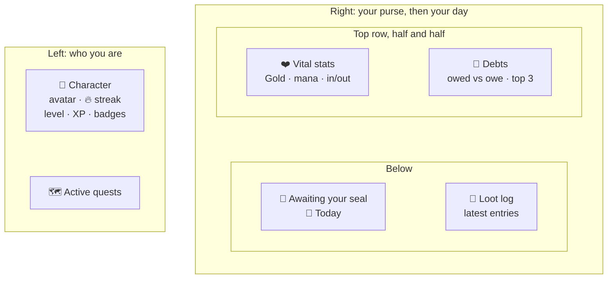

The breakpoints, by the room the page actually has:

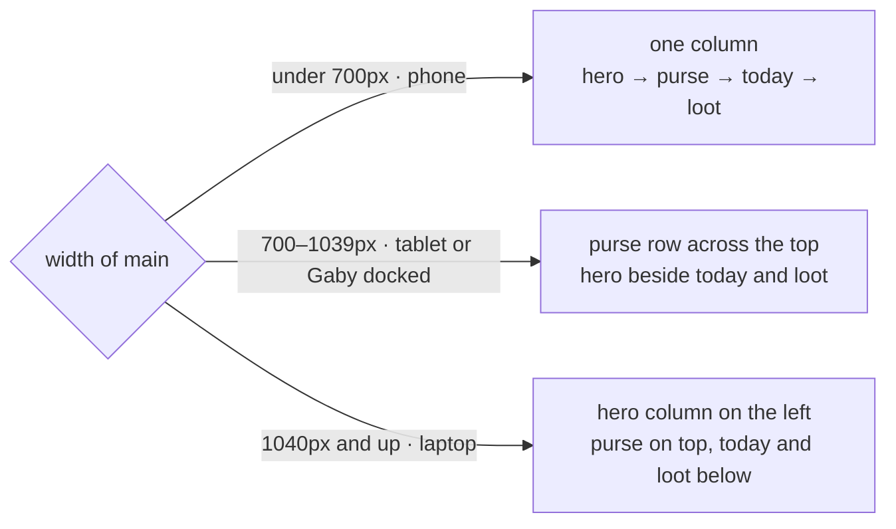

## Finance

### Ledger

Every movement of money, month by month: income, expenses and transfers between
accounts. Filter by account or category; see the month's income, spending and net.
Logging an entry earns XP (see below). Entries made by a recurring rule are marked.

### Budgets ("mana")

Give an expense category a monthly budget and it appears here as a mana bar: budget,
spent and left, plus the month's total and anything spent outside a budget. Finishing a
month within a category's budget earns +50 XP for that budget.

### Quests

Savings goals: a name, an icon, a target and an optional deadline. Put money towards a
quest (or take some back); reaching the target completes it for +200 XP and the
*Quest complete* badge. A completed quest stays completed.

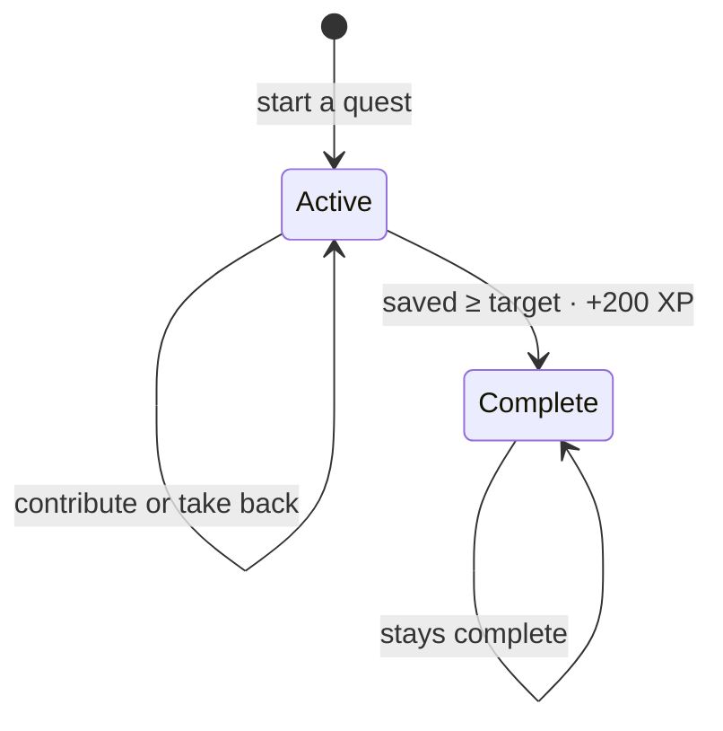

### Recurring

Salary, rent, subscriptions: things that happen on the same day every month. Each one
says how it's logged **on the day**:

- **Log it by itself** (*Auto*): the nightly job books it at 00:05. For fixed amounts
  like salary or rent.
- **Wait for my confirm** (*Confirm*): on its day it shows up in the Hall under
  *Awaiting your seal*. Open it to check or correct this month's amount, then
  **Confirm** (it's booked and earns entry XP), or **Skip this time** (nothing is booked;
  it moves to next month). For bills that vary, like electricity, or anything you want
  to check before it's recorded. If several months were missed, they come up one at a
  time, oldest first.

Days 29–31 fall on the last day of shorter months. Pausing a rule stops it; deleting it
keeps the entries it already made. If the server was down over a payday, auto rules catch
up when it starts.

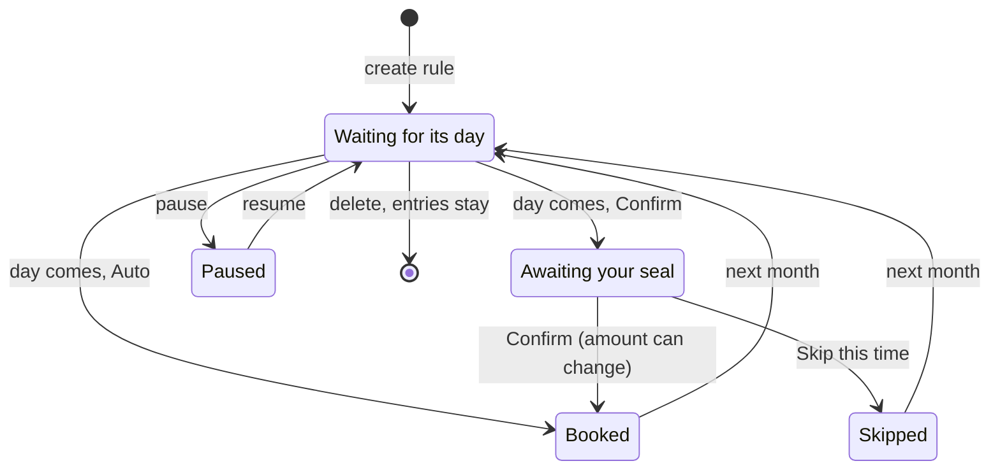

Sealing one, step by step:

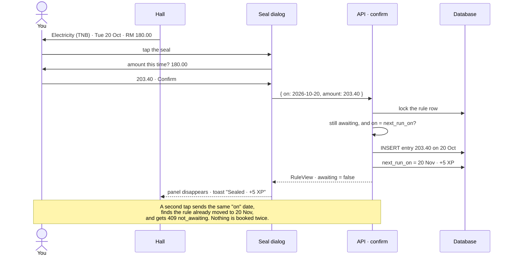

### Debts

A memory of money between you and other people, kept apart from the ledger (it's about
who owes whom, not money in an account).

- **Owed to you** and **You owe** columns, each debt with the person, what it was for,
  a repaid bar, and a due date (red when overdue).
- **They paid / I paid** records a repayment, in parts if needed. Paying the last of it
  settles the debt: +10 XP the first time and the *Clean slate* badge.
- **Let the rest go** settles it without the rest being paid (forgiven, written off).
  It can be opened again.
- Repayments recorded by mistake can be removed; a debt that's owed again reopens.
- Settled debts move to a collapsible *Settled* list.

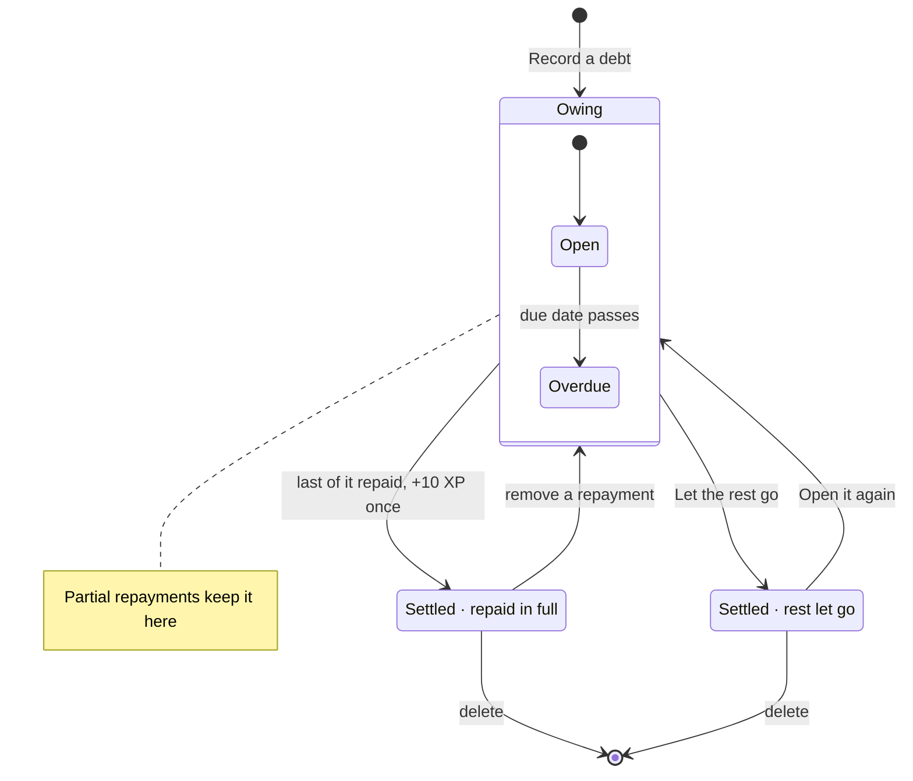

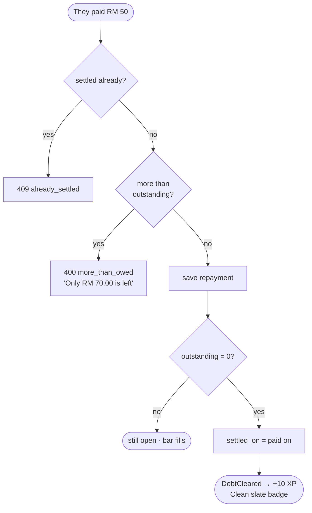

### Accounts

Where the money is kept: bank, cash, e-wallet, card, other, each with an opening balance.
Balances are always computed from the entries. Deleting an account with history archives
it instead (hidden from pickers, history kept); it can be restored.

## Life

### Calendar

A month grid with dots on busy days; pick a day to see and edit its events. Events can be
all-day or at a time. The next few appear in the Hall's Today panel.

### Vitals

- **The feast**: meals with calories against your daily goal, and the last 7 days as a
  bar chart. Logging any meal on a day earns +5 XP once for that day.
- **Training grounds**: workouts planned on certain weekdays (or any day). Ticking one
  earns +10 XP, once per workout per day. Each workout keeps a streak of *planned* days
  done in a row, so resting on an unplanned day doesn't break it.

### Workshop

An idea board in three columns: to do, doing, done. Finishing an idea earns +15 XP.

## Arcane

### Steward (Gaby)

Chat with Gaby, the realm's steward, who can read and change everything above through
tools: log spending, check budgets, add a recurring bill, confirm one, record that Ali
paid you back, plan a workout. She answers in the mix of English and Malay you use, with
a light medieval flavour, plus a one-line English subtitle. On wide screens she can be
docked in a right-hand column on any page. See [GABY.md](GABY.md).

### Oracle's Eye

Shows what your Anthropic organisation spent on Claude, day by day. It calls the
Anthropic Admin API straight from the browser with an admin key you paste in; the key is
kept in your browser only and never reaches KrugWorld's server.

## Settings

- **Skin**: *Classic Krugger* (the old Tavern exactly: pixel fonts, teal stone, square
  borders, scanlines) or *KrugWorld* (Pirata One + Barlow Condensed) with four
  backgrounds: Knight's steel (default), oak, forest, parchment.
- **Recovery email**: needed to reset a forgotten passphrase by email.
- **Desk Gaby**: make a pairing code, see and remove paired devices.
- **Import from Krugger's Tavern**: one-off import of the old app's data.
- **Weather**: your location and °C/°F.

## Game rules

### XP

| Action | XP | Limit |
|---|---|---|
| Log a ledger entry (incl. confirming a recurring one) | 5 | first 10 entries a day |
| Log a meal | 5 | once per day |
| Tick a workout | 10 | once per workout per day (unticking and re-ticking pays nothing) |
| Finish an idea | 15 | once per idea |
| Keep a budget for a finished month | 50 | per budgeted category per month, up to a year back |
| Complete a quest | 200 | once per quest |
| Clear a debt in full | 10 | once per debt |

Entries booked automatically by the nightly job earn nothing: XP is for things you did.
Every reward is recorded once in `xp_event`, so nothing can be paid twice.

Where a typical active week's XP comes from (an illustration, not a rule):

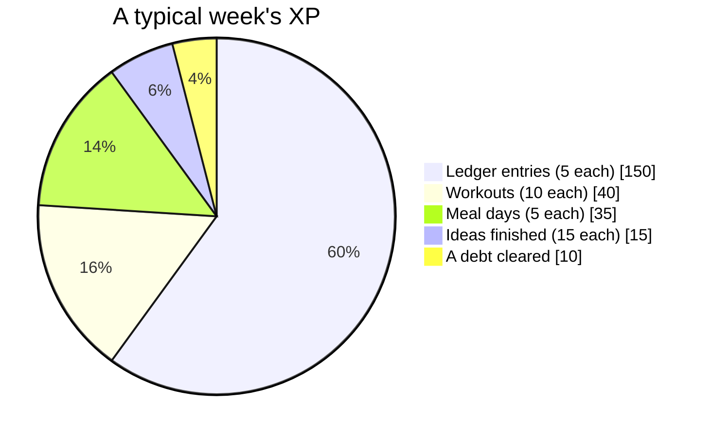

### Levels

Reaching level *n* takes `50 × n × (n − 1)` XP in total: 0, 100, 300, 600, 1000, 1500, …
Each level needs 100 more than the one before, so early levels come fast and later ones
need real habits.

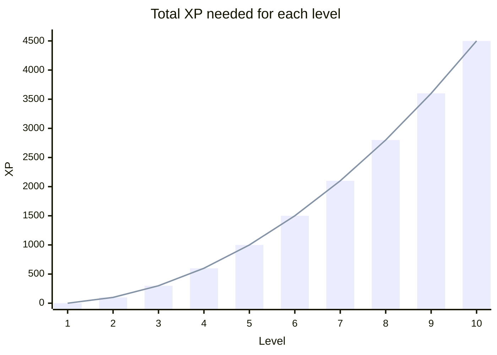

| Level | Title |
|---|---|
| 1 | Wanderer |
| 2 | Villager |
| 3 | Apprentice |
| 4 | Journeyman |
| 5 | Adept |
| 6 | Veteran |
| 7 | Champion |
| 8 | Keeper of the Realm |
| 9+ | Legend of KrugWorld |

### Streaks

A day counts if you earned any *activity* XP that day: an entry, a meal, a workout or a
finished idea. The streak is the number of days in a row up to today; today still counts
as "in progress", so the streak doesn't drop to 0 until a whole day passes empty.
Days follow the app's time zone (Asia/Kuala_Lumpur by default).

The flame on your avatar shows which state you're in:

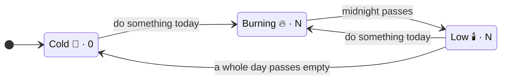

### Badges

| Badge | How |
|---|---|
| First coin | Log your first entry |
| Week warrior | Be active 7 days in a row |
| Iron habit | Be active 30 days in a row |
| Budget keeper | Finish a month within a budget |
| Quest complete | Reach a savings goal |
| No-spend Sunday | Spend nothing on a Sunday you were tracking (something logged within 3 days) |
| Hoard of a thousand | Hold RM 1,000 across your accounts |
| First feast | Log a meal |
| Iron body | Finish 10 workouts |
| Idea smith | Finish an idea in the Workshop |
| Clean slate | Have a debt paid back in full |
| Adept | Reach level 5 |
