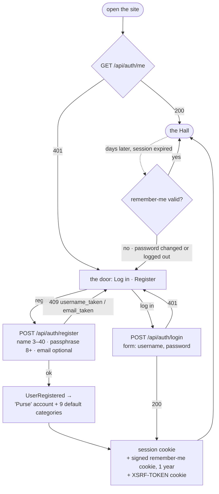
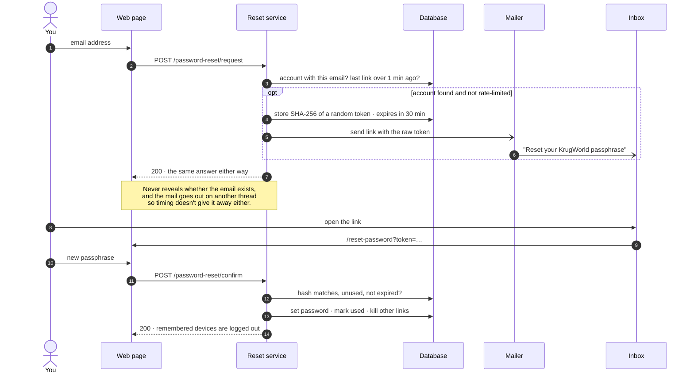
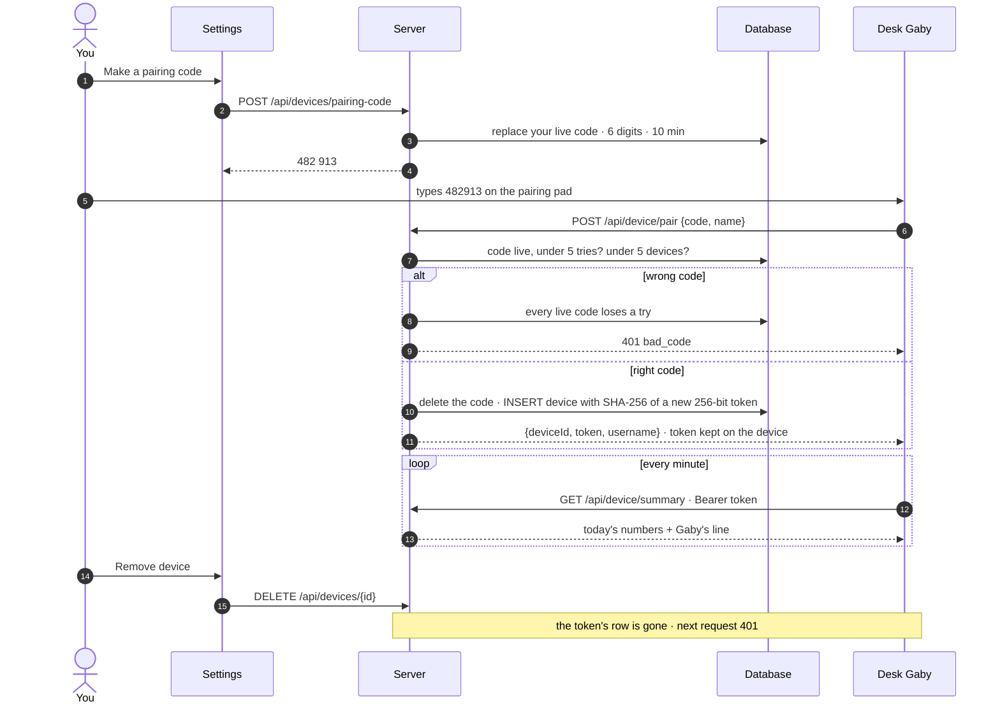
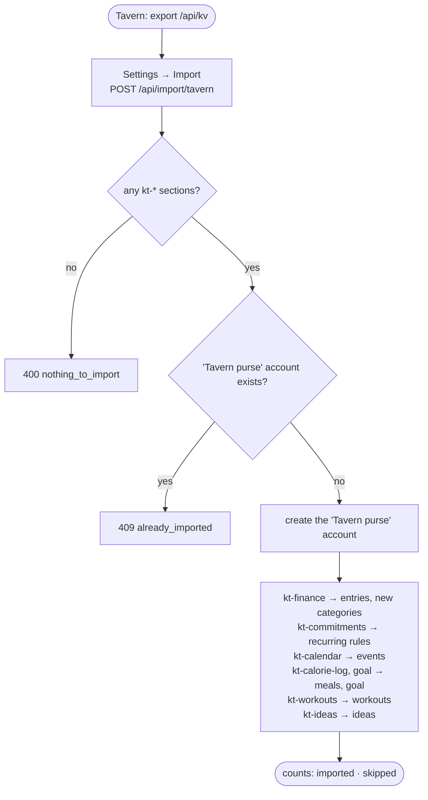
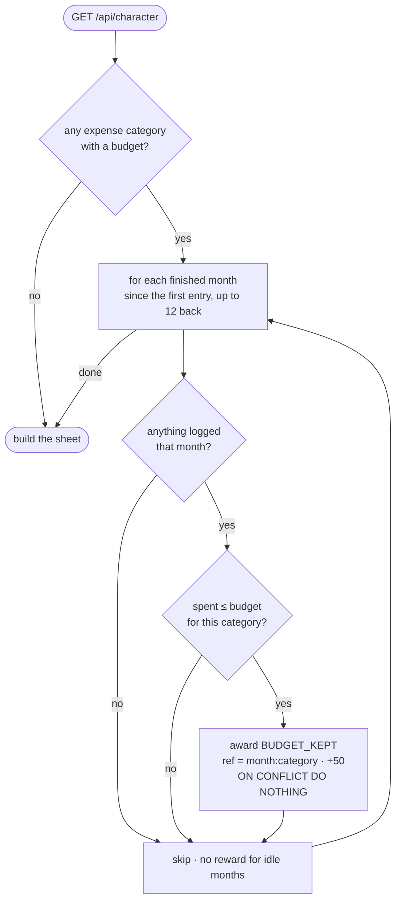
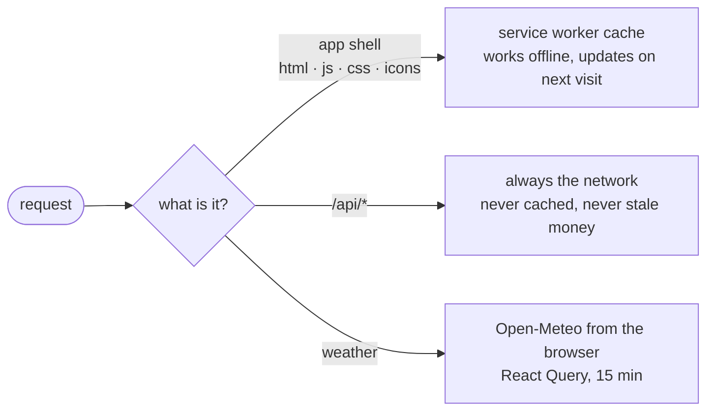

# Flows: KrugWorld in pictures

Every diagram in the documentation, plus the journeys that don't belong to one page.
The diagrams are [Mermaid](https://mermaid.js.org/), which GitHub renders straight from
the Markdown (in VS Code, install a Mermaid preview extension).

## Diagram index

| Topic | Diagram | In |
|---|---|---|
| The whole system | flowchart: clients → nginx → Spring → Postgres / AI | [ARCHITECTURE](ARCHITECTURE.md#architecture) |
| Logging an entry end to end | sequence | [ARCHITECTURE](ARCHITECTURE.md#life-of-a-request) |
| Layers | flowchart: controller → service → JPA / JdbcTemplate | [ARCHITECTURE](ARCHITECTURE.md#layers-and-conventions) |
| How XP is paid | flowchart: events → Rewards → `xp_event` | [ARCHITECTURE](ARCHITECTURE.md#domain-events-and-rewards) |
| Nightly recurring job | flowchart | [ARCHITECTURE](ARCHITECTURE.md#scheduling) |
| Which security chain | decision tree | [ARCHITECTURE](ARCHITECTURE.md#security) |
| Frontend writes and structure | flowcharts | [ARCHITECTURE](ARCHITECTURE.md#frontend) |
| Schema history | timeline | [DATABASE](DATABASE.md#migrations) |
| Every table | 4 ER diagrams: ledger · debts and quests · game and life · security | [DATABASE](DATABASE.md#entity-relationships) |
| Derived numbers | flowchart: balance, outstanding, mana, level, streak | [DATABASE](DATABASE.md#how-derived-numbers-are-computed) |
| App map | mind map | [FEATURES](FEATURES.md) |
| A day in KrugWorld | user journey | [FEATURES](FEATURES.md#a-day-in-krugworld) |
| The Hall's layout and breakpoints | block diagram + flowchart | [FEATURES](FEATURES.md#the-hall) |
| Recurring entry lifecycle | state diagram | [FEATURES](FEATURES.md#recurring) |
| Sealing a bill | sequence | [FEATURES](FEATURES.md#recurring) |
| Quest lifecycle | state diagram | [FEATURES](FEATURES.md#quests) |
| Debt lifecycle and repayment rules | state diagram + flowchart | [FEATURES](FEATURES.md#debts) |
| Where XP comes from | pie | [FEATURES](FEATURES.md#xp) |
| Level curve | XY chart | [FEATURES](FEATURES.md#levels) |
| Streak flame | state diagram | [FEATURES](FEATURES.md#streaks) |
| Gaby's tool loop | sequence | [GABY](GABY.md#how-a-message-is-answered) |
| Gaby's language rule | flowchart | [GABY](GABY.md#character) |
| Choosing the AI provider | flowchart | [GABY](GABY.md#providers-and-configuration) |
| Spend guards | flowchart | [GABY](GABY.md#spend-guards) |
| Voice on the desk device | sequence | [GABY](GABY.md#voice-desk-device) |
| Local dev setup | flowchart | [DEVELOPMENT](DEVELOPMENT.md#run-it-locally) |
| How the tests are wired | flowchart | [DEVELOPMENT](DEVELOPMENT.md#tests) |
| Adding a feature | flowchart | [DEVELOPMENT](DEVELOPMENT.md#adding-a-feature-checklist) |
| The server | flowchart | [OPERATIONS](OPERATIONS.md#where-it-runs) |
| A release | flowchart: PC → server → health | [OPERATIONS](OPERATIONS.md#how-a-release-works) |
| "Not healthy" troubleshooting | decision tree | [OPERATIONS](OPERATIONS.md#when-redeploysh-says-not-healthy) |
| The 23 Oct incident | git graph + timeline | [OPERATIONS](OPERATIONS.md#lessons) |
| Push-to-deploy (proposed) | flowchart | [OPERATIONS](OPERATIONS.md#lessons) |

The rest are below.

## Signing up and staying signed in

## Forgot the passphrase

## Pairing a desk Gaby

## Importing from Krugger's Tavern

## "Budget kept" XP, checked lazily

There's no month-end job: the reward is re-checked every time the Hall loads, and the
unique key on `xp_event` makes re-checking free.

## Offline and the PWA

