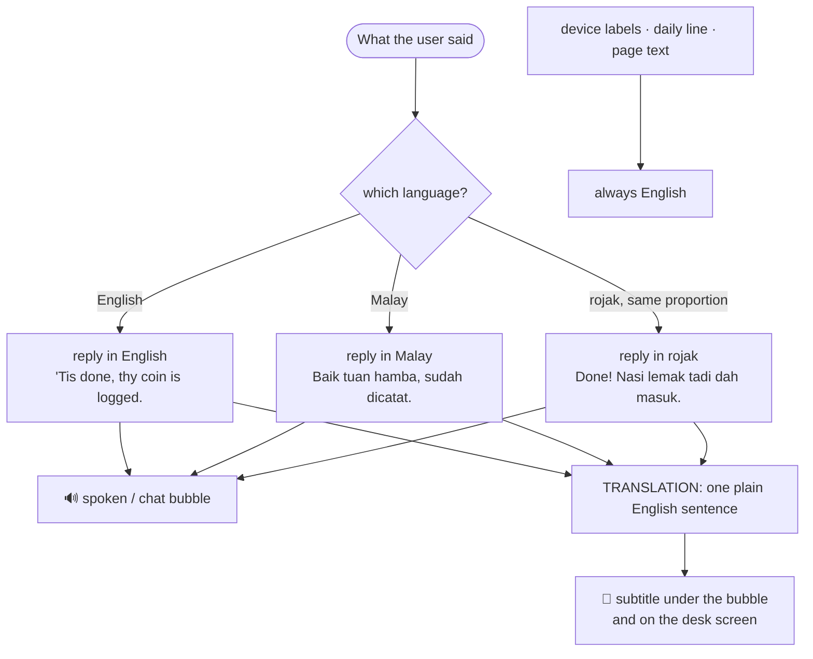
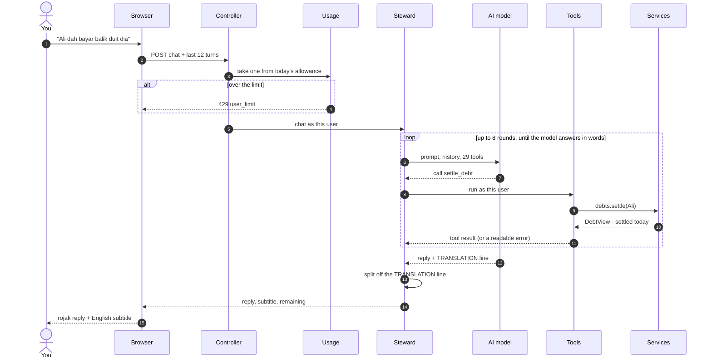
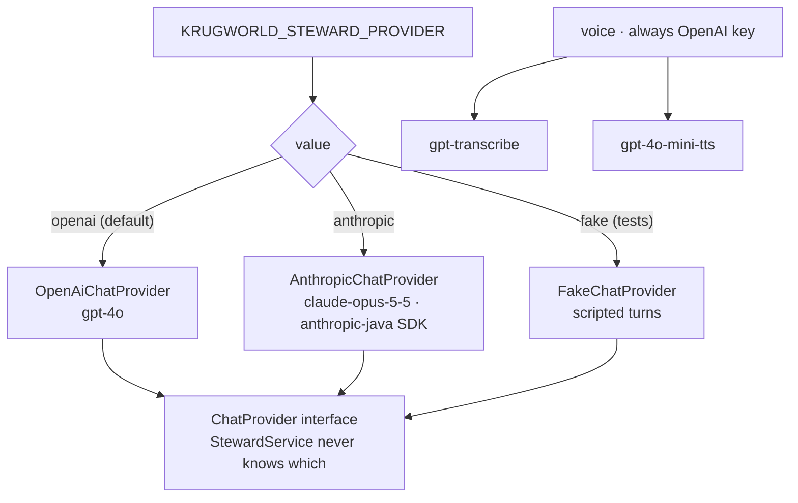
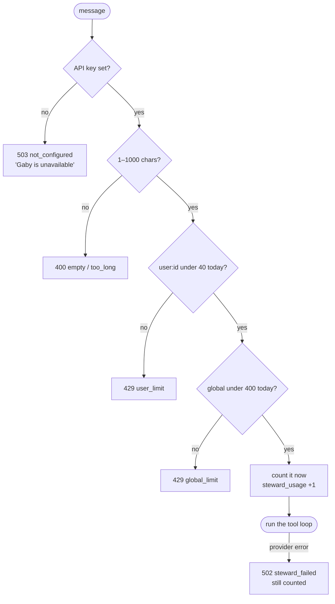
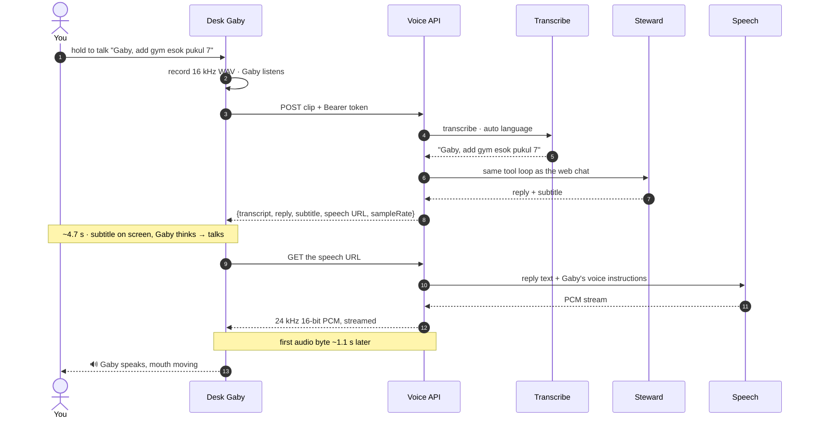

# Gaby, the Steward

Gaby is KrugWorld's AI helper: a cheerful young steward in a medieval keep who keeps the
realm's books. She can read and change everything in the app through tools, in the web
chat, in the dock beside any page, and by voice on the desk device.

## Character

- **Look:** a female pixel-art portrait (`frontend/src/steward/Portrait.tsx`): burgundy
  cap with a gold feather, gold spectacles, teal coat, auburn braids. She blinks, rolls
  her eyes up while thinking and moves her mouth while talking (`useMood`).
- **Voice in text:** warm, a little playful, a light medieval flavour (the odd *thee* or
  *'tis*; in Malay a touch of classical courtesy like *hamba*, *tuan hamba*). Replies are
  a sentence or two, short enough to be read aloud on a small speaker.
- **Language:** the user mixes English and Malay. Gaby answers in **the same mix and
  proportion** the user used: English to English, rojak to rojak. Malay food and place
  names are never translated.
- **Screen text is English.** Only her spoken/chat reply is rojak. Each final reply ends
  with a `TRANSLATION:` line, one plain English sentence, which the server strips off and
  returns as `subtitle`. Labels on the device and her daily line are English too.

## How a message is answered

The reply in that example: *"Baik tuan hamba, hutang Ali dah selesai, saya tandakan."* with the
subtitle *"Ali's debt is settled; I've ticked it off."*

- **Stateless.** The server keeps no conversation. The browser sends the last few turns
  (`history-turns`, 12) with each message, so a redeploy or a second tab never loses or
  mixes anything.
- **Tools are thin wrappers over the real services.** Gaby's actions go through the same
  ownership checks, validation and XP as the screens. She can't do anything the user
  couldn't, and her actions count towards streaks.
- **A backstop of 8 tool rounds** stops a runaway loop; a normal answer takes one to three.
- **Tool failures are readable.** An `ApiException` (e.g. "Only RM 70.00 is left to pay")
  goes back to the model as an error result, and she explains it in character.
- The system prompt includes today's date and weekday, so "esok" and "last Tuesday" resolve
  correctly.

## Tools

| Area | Tools |
|---|---|
| Overview | `get_overview` (the character sheet) |
| Money | `list_accounts`, `list_categories`, `list_entries`, `add_entry`, `delete_entry` |
| Budgets | `get_budgets`, `set_budget` |
| Recurring | `list_recurring`, `add_recurring` (with `auto` true/false), `confirm_recurring` (confirm, change the amount, or `skip`) |
| Debts | `list_debts`, `add_debt`, `settle_debt` (by person's name; the oldest open debt if several) |
| Quests | `list_quests`, `add_quest`, `contribute_to_quest` |
| Calendar | `list_events`, `add_event`, `delete_event` |
| Meals | `get_meals`, `add_meal` (estimates calories if not given), `set_calorie_goal` |
| Training | `list_workouts`, `add_workout`, `mark_workout_done` |
| Workshop | `list_ideas`, `add_idea`, `set_idea_status` |

Things people name (accounts, categories, quests, people) are looked up by name, ignoring
case; when a name doesn't match, the error lists the valid choices so the model can
recover. Things people don't name (entries, events, ideas) use ids from the `list_*` tools.

To add a tool: add a `StewardTool` in `StewardTools.define()` with a JSON-schema
(`Schema.object/props/string/...`) and a handler calling an existing service, then extend
`StewardIntegrationTest` with a scripted `FakeChatProvider` turn.

## Providers and configuration

OpenAI is the default for everything (brain, speech-to-text, text-to-speech), so one key
covers it all. Claude is available by switching one variable.

| Variable | Default | Meaning |
|---|---|---|
| `KRUGWORLD_STEWARD_PROVIDER` | `openai` | `openai` or `anthropic` |
| `OPENAI_API_KEY` | | brain, ears and voice |
| `KRUGWORLD_STEWARD_OPENAI_MODEL` | `gpt-4o` | chat model |
| `ANTHROPIC_API_KEY` | | when the provider is `anthropic` |
| `KRUGWORLD_STEWARD_MODEL` | `claude-opus-5-5` | Claude model (official `anthropic-java` SDK) |
| `KRUGWORLD_STEWARD_EFFORT` | `low` | Claude effort |
| `KRUGWORLD_STEWARD_DAILY_LIMIT` | `40` | messages per account per day |
| `KRUGWORLD_STEWARD_GLOBAL_DAILY_LIMIT` | `400` | messages for the whole app per day |
| `KRUGWORLD_TRANSCRIBE_MODEL` | `gpt-transcribe` | speech-to-text |
| `KRUGWORLD_TRANSCRIBE_LANGUAGE` | blank (auto-detect) | `ms` forces Malay; auto works well for rojak |
| `KRUGWORLD_SPEECH_MODEL` | `gpt-4o-mini-tts` | text-to-speech |
| `KRUGWORLD_SPEECH_VOICE` | `coral` | her voice (chosen by the owner) |

With no key, the Steward page says Gaby is unavailable (`503 not_configured`) instead of
failing.

## Spend guards

A server-held key plus open registration needs a cap. `StewardUsage` keeps per-account and
global counters per day in `steward_usage` (so a mid-day redeploy doesn't reset them). A
message counts when accepted, not when it succeeds, so a failing provider can't become a
free retry loop. Over the limit: `429 user_limit` or `429 global_limit`. Messages are
capped at 1000 characters.

## Voice (desk device)

Tap-to-talk on the ESP32: the device records a WAV clip and posts it to
`/api/device/voice`. The server transcribes it (`gpt-transcribe`), runs the same
`StewardService` (there is no second assistant), returns the text reply and subtitle,
and streams her speech as 24 kHz 16-bit PCM from `gpt-4o-mini-tts` with voice
instructions for Gaby's accent. Measured on 2026-10-12: about 4.7 s to the text reply and
1.1 s more to the first audio byte. Details: [DEVICE-API.md](DEVICE-API.md).

On the device's home screen Gaby also has a **daily line** (`GabyLine`): picked by plain
rules from the user's day (most urgent first, a greeting otherwise), with no AI call, so
refreshing it every minute costs nothing.

## Testing

Tests never call a real provider. `IntegrationTest` boots the app with
`krugworld.steward.provider=fake`; `FakeChatProvider` replays scripted turns (including
tool calls), and `FakeSpeechProvider` stands in for transcription and speech. No network,
no cost, deterministic.
