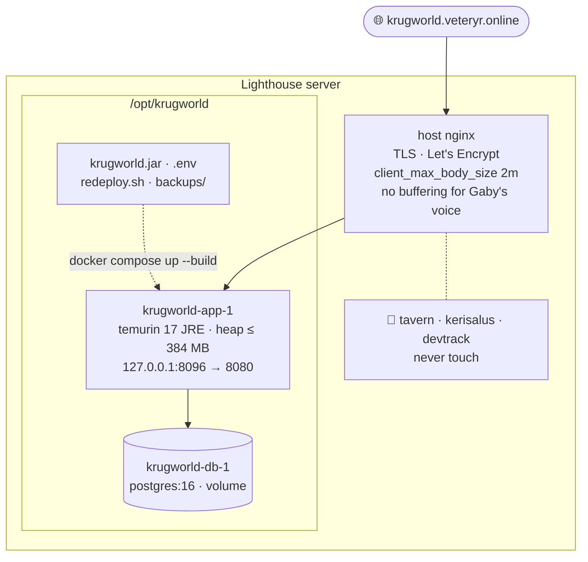
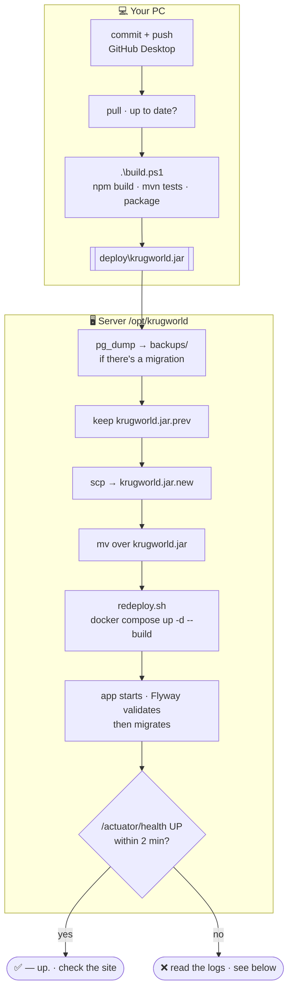
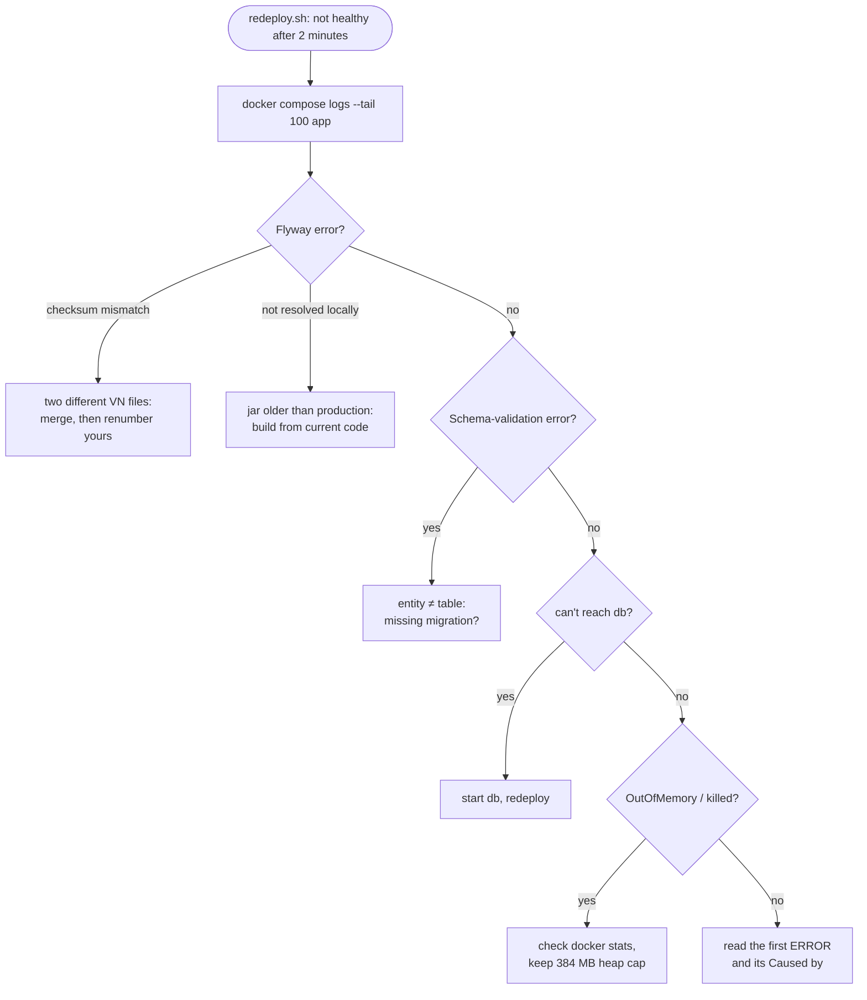
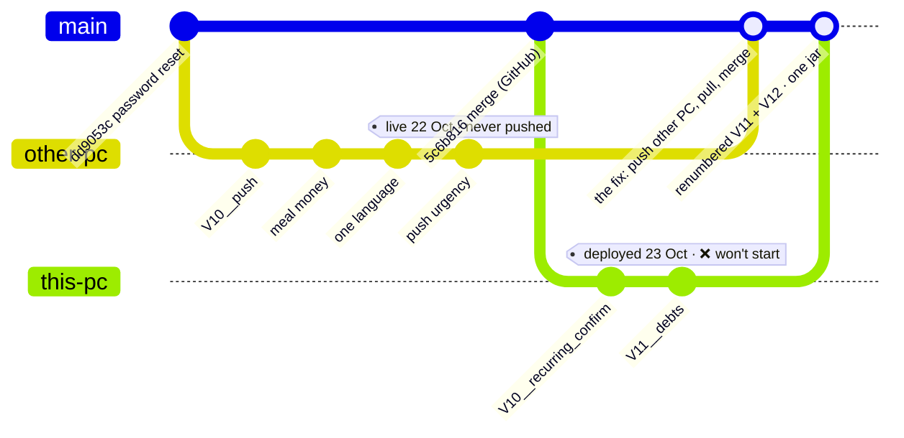
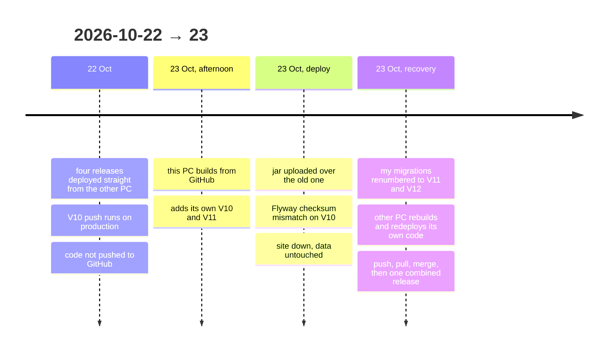
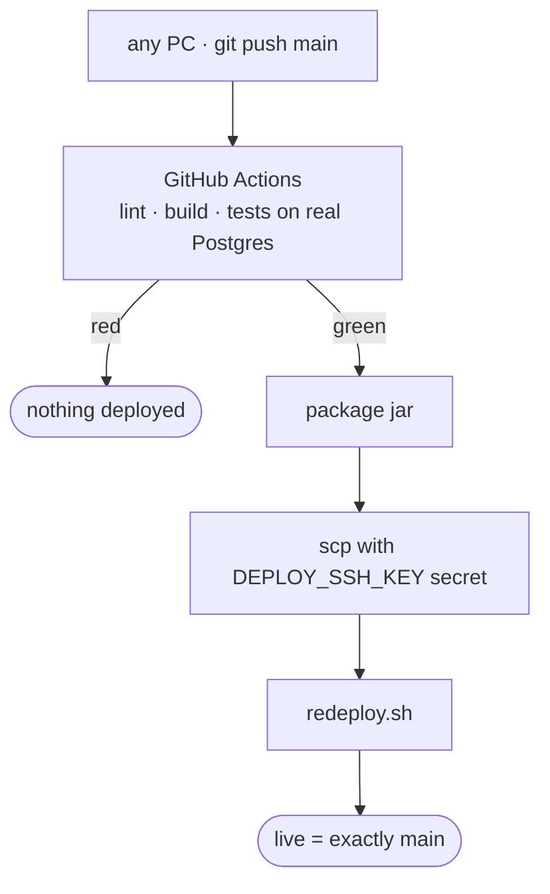

# Operations

Running the live site: releasing, checking, backing up and recovering. The first-time
server setup (DNS, nginx, certbot, `.env`) is in [`../DEPLOY.md`](../DEPLOY.md).

## Where it runs

| | |
|---|---|
| Address | https://krugworld.veteryr.online (Let's Encrypt, auto-renew) |
| Server | Tencent Lighthouse, `ubuntu@43.156.150.155`, **shared** with the Tavern, kerisalus and devtrack: never touch their containers |
| Folder | `/opt/krugworld` (`docker-compose.yml`, `Dockerfile`, `.env`, `krugworld.jar`, `redeploy.sh`, `backups/`) |
| Containers | `krugworld-app-1` (the jar on `eclipse-temurin:17-jre`, heap capped at 384 MB) and `krugworld-db-1` (`postgres:16`) |
| Port | app on `127.0.0.1:8096`, behind the host nginx |
| Secrets | `/opt/krugworld/.env`: `POSTGRES_PASSWORD`, `OPENAI_API_KEY`, optional SMTP settings |
| SSH | `ssh -i ~/.ssh/krugworld_lighthouse ubuntu@43.156.150.155`. Each PC has its own key; add a new PC's public key to `~/.ssh/authorized_keys` through the Lighthouse console's OrcaTerm |



## How a release works

The server never builds anything (it's small and shared). A release is:

1. **build the jar** on a PC (frontend build + backend tests + package),
2. **copy** it to `/opt/krugworld/krugworld.jar`,
3. **run `redeploy.sh`** on the server: it rebuilds the app image around the jar,
   restarts the container, and waits until `/actuator/health` says `UP` (up to 2 minutes).

Flyway applies new migrations when the app starts, so there's no manual database step.
`redeploy.sh` doesn't pull from GitHub; it deploys whatever jar is in the folder.



## Release checklist

1. **Release only from code that is on GitHub.** Commit and push first; on the PC you
   release from, pull so it has everything. A jar built from an out-of-date checkout
   silently removes features that were live (see *Lessons* below).
2. If the release adds a migration, check its number is above production's:
   ```bash
   ssh -i ~/.ssh/krugworld_lighthouse ubuntu@43.156.150.155 \
     "cd /opt/krugworld && docker compose exec -T db psql -U krugworld -d krugworld -Atc 'SELECT max(version::int) FROM flyway_schema_history'"
   ```
3. Build: `.\build.ps1` (or in Git Bash: `cd frontend && npm run build`, then
   `cd backend && ./mvnw -q package`, then copy `backend/target/krugworld-0.1.0.jar` to
   `deploy/krugworld.jar`).
4. Back up the database (below) if the release has a migration.
5. Keep the current jar as the rollback, upload the new one beside it, then swap:
   ```powershell
   ssh -i $HOME\.ssh\krugworld_lighthouse ubuntu@43.156.150.155 "cp /opt/krugworld/krugworld.jar /opt/krugworld/krugworld.jar.prev"
   scp -i $HOME\.ssh\krugworld_lighthouse deploy\krugworld.jar ubuntu@43.156.150.155:/opt/krugworld/krugworld.jar.new
   ssh -i $HOME\.ssh\krugworld_lighthouse ubuntu@43.156.150.155 "mv /opt/krugworld/krugworld.jar.new /opt/krugworld/krugworld.jar && /opt/krugworld/redeploy.sh"
   ```
   The `.new` name means a broken upload is never the jar that starts.
6. Expect `Waiting for KrugWorld…… — up.` Then open the site (Ctrl+F5 past the PWA
   cache) and check the Hall and anything the release changed.

## When `redeploy.sh` says "not healthy"

```bash
ssh -i ~/.ssh/krugworld_lighthouse ubuntu@43.156.150.155 "cd /opt/krugworld && docker compose logs --tail 100 app"
```

| Log says | Meaning | Fix |
|---|---|---|
| `Migration checksum mismatch for migration version N` | the jar has a different `VN` file from the one that already ran | rebuild from code that has production's `VN` (pull/merge), renumber your new migration above it |
| `Detected applied migration not resolved locally` | production ran a migration this jar doesn't have | the jar is older than production: build from up-to-date code |
| `Schema-validation: missing column/table` | an entity doesn't match the database | a migration is missing from the jar, or an entity is wrong |
| connection refused to `db` | the database container is down | `docker compose up -d db`, then `redeploy.sh` |

A failed start changes nothing in the database: Flyway validates before it migrates, and
Hibernate validates before anything runs. If the site must be up right away, roll back to
`krugworld.jar.prev` first and investigate after.



## Rolling back

If the old jar was kept (checklist step 5):

```bash
ssh -i ~/.ssh/krugworld_lighthouse ubuntu@43.156.150.155 "cp /opt/krugworld/krugworld.jar.prev /opt/krugworld/krugworld.jar && /opt/krugworld/redeploy.sh"
```

An older jar normally starts on the newer schema a release left behind. Flyway treats
migrations newer than any it knows as "future" and lets them be, and Hibernate ignores
tables and columns it doesn't map. It breaks only if the new migration added something
the old code trips over, like a `NOT NULL` column without a default that old inserts
leave out; then restore the backup taken before the release. (A *gap* is different: if
production has a migration in the middle that the jar lacks, as with V10 on 2026-10-23,
Flyway refuses. That's the "not resolved locally" row above.)

Without a kept jar: rebuild the previous version from git (`git checkout <commit>`, build,
deploy), which is another reason to only release pushed commits.

## Backups

Before any release with a migration, and whenever you like:

```bash
ssh -i ~/.ssh/krugworld_lighthouse ubuntu@43.156.150.155 \
  "cd /opt/krugworld && docker compose exec -T db pg_dump -U krugworld krugworld | gzip > backups/before-<what>-\$(date +%F-%H%M).sql.gz"
```

Copy one down to your PC now and then:

```powershell
scp -i $HOME\.ssh\krugworld_lighthouse ubuntu@43.156.150.155:/opt/krugworld/backups/<file>.sql.gz .
```

Restore (this **replaces** the live data; stop the app first):

```bash
cd /opt/krugworld
docker compose stop app
gunzip -c backups/<file>.sql.gz | docker compose exec -T db psql -U krugworld -d krugworld --single-transaction \
  -c 'DROP SCHEMA public CASCADE; CREATE SCHEMA public;' -f -
docker compose start app
```

## Configuration on the server

`.env` is read by `docker compose`. After editing it, apply with
`docker compose up -d app` (a plain `restart` doesn't re-read `.env`). Keep one line per
key: a pasted key with a stray newline breaks the HTTP header it's sent in.

| Variable | Purpose |
|---|---|
| `POSTGRES_PASSWORD` | database password (app and db containers) |
| `OPENAI_API_KEY` | Gaby (see [GABY.md](GABY.md) for the other `KRUGWORLD_*` settings) |
| `SMTP_HOST`, `SMTP_PORT`, `SMTP_USERNAME`, `SMTP_PASSWORD`, `MAIL_FROM`, `PUBLIC_URL` | password reset by email (port 587; Tencent blocks 25) |

## Health and monitoring

- `https://krugworld.veteryr.online/actuator/health` → `{"status":"UP"}`
- `https://krugworld.veteryr.online/api/status` → the applied schema version
- `docker compose ps` / `docker compose logs -f app` on the server
- Mail health is excluded from `/actuator/health`, so a dead SMTP server can't block a
  redeploy.

## Lessons

**2026-10-23: deploying from a checkout that was behind production.** On 22 Oct, four
releases (push notifications with `V10__push.sql`, meal money, one language, push
urgency) were deployed from one PC without being pushed to GitHub. The next day another PC
built from GitHub, added its own `V10`, and deployed. Flyway refused to start (checksum
mismatch on V10), so the site went down, though no data was touched, and the previous
jar had been overwritten, so there was nothing to roll back to. The fix was to redeploy
from the PC that had the live code.





What changed afterwards:
- release only pushed code, from an up-to-date checkout (checklist step 1);
- number migrations from production's latest version (checklist step 2);
- keep `krugworld.jar.prev` as an instant rollback (checklist step 5).

A next step worth doing: let GitHub Actions build the jar after the tests pass and deploy
it (a deploy SSH key as a repository secret). Then there's only one place a release can
come from.


